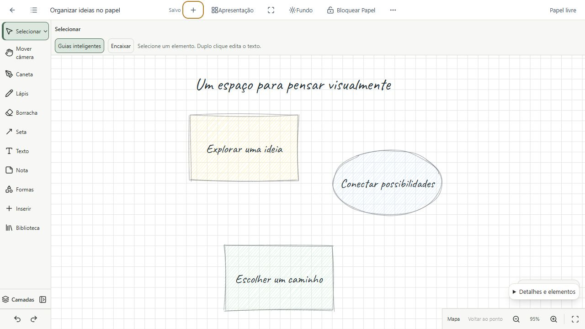
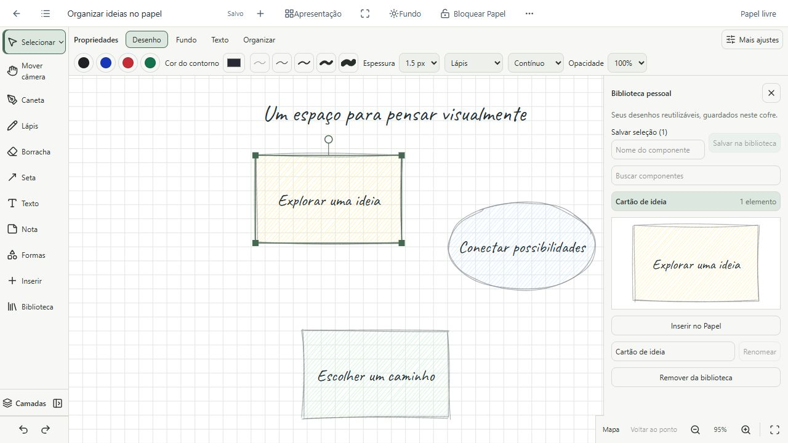
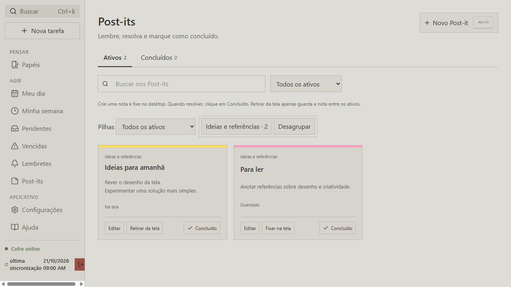
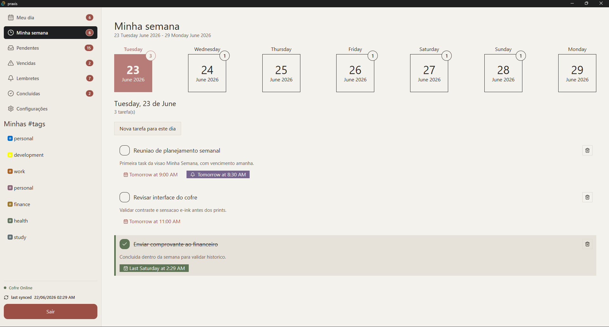
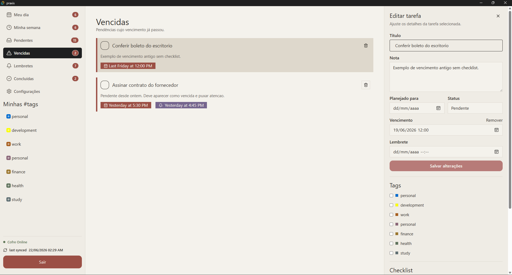
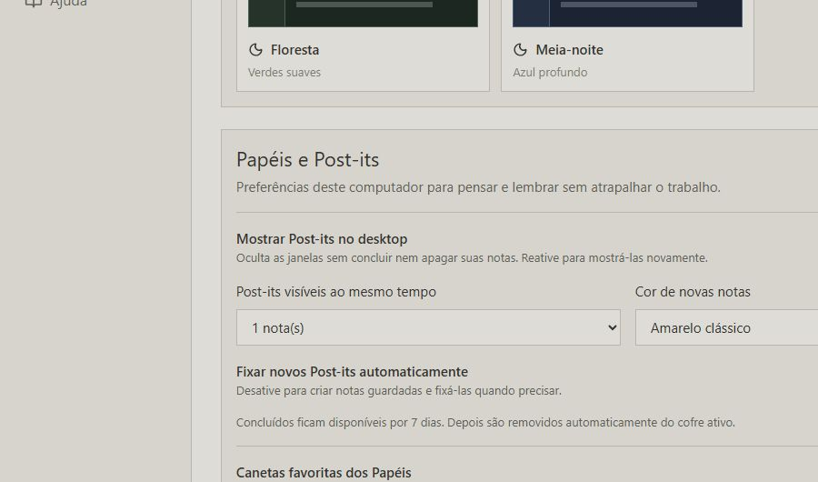

# Praxis

**Think on digital paper. Remember what matters. Turn ideas into action.**

Praxis is a private desktop workspace that brings visual thinking, daily tasks and small desktop notes into one encrypted local vault. Its interface takes inspiration from calm e-ink screens.

## Three spaces, one workspace

| Space | What it is for |
| --- | --- |
| **Papéis / Papers** | Infinite digital sheets for ideas, sketches, diagrams, wireframes and presentations. |
| **Tasks and reminders** | Actions with dates, checklists, tags and notifications. |
| **Post-its** | Independent text notes pinned on your desktop until you finish them. |

**Papéis** is the Portuguese product name: literally sheets of paper. In English the name is **Papers**; singular **Papel / Paper**. A Paper is a flexible digital sheet, not a task-specific refinement template. Post-its are separate notes and do not require a task or scheduled reminder.

## Papéis · Papers



- Infinite canvas with a side atelier and a contextual top bar.
- Pen, pencil, graphite, fountain pen and ink for handwriting and sketches.
- Straight lines, rectangles, ellipses, triangles, hexagons, arrows and connectors.
- Editable text with four quick font sizes, bold, italic, alignment and hand-drawn annotations.
- Plain, grid, ruled and dotted backgrounds in light or dark appearance.
- Layers, groups, lasso selection, smart alignment guides, copy/paste and undo/redo.
- Notebook organization, content previews and a personal reusable component library.
- Presentation scenes, laser pointer, focus mode and image export.
- Optional task links preserve context without duplicating the Paper.



Papers support personal use, screen sharing and explicit export. See [the product concept](docs/PAPER_CONCEPT.md), [tools and shortcuts](docs/PAPER_TOOL_EXPERIENCE.md) and [usage limits](docs/BOARDS.md).

## Post-its on your desktop



Write a free note and choose Micro, Compact or Expanded per note. Micro uses a single colored line with its title; hover or keyboard focus opens a temporary preview. Edit directly without reopening the organizer.

- **Alt+N** in Post-its starts a note with focus on the text.
- Text autosaves after a short pause; **Ctrl+Enter** or **Escape** finishes editing. The title is optional.
- Choose and lock the preferred mode, drag the grip, or resize Expanded notes. Temporary previews preserve saved positions.
- Select notes in the organizer to create named piles. A pile uses one desktop window and opens its members on demand; ungrouping preserves them.
- Search title and body across individual and grouped notes, with highlighted matches.
- **Done** removes the window and keeps the note recoverable for seven days.
- **Reopen** cancels the removal deadline. Active notes do not expire.
- Completed notes are removed from the active vault after seven days; if the vault is closed, cleanup runs when it opens again. Existing encrypted safety copies keep their separate retention policy.

Desktop notes require Praxis to be running with an unlocked vault. Settings controls whether they are displayed, the visible limit (one to three), automatic pinning and the default color. A pile counts as one window. Additional pinned notes wait in the queue.

## Tasks, planning and reminders



- My day, the next seven days, pending work, overdue tasks and reminders.
- Task notes, tags, checklists and lifecycle history.
- Checklists describe execution steps; dates and reminders belong to the task.
- Taskbar badge and background reminders keep pending work visible.
- Closing the main window while the vault is unlocked keeps Praxis resident.



## Settings and illustrated Help

Settings groups appearance, language, notifications, startup, task retention and the new **Papers and Post-its** preferences. Favorite drawing pens can be cleared there; each Paper keeps its own background and appearance.



Help includes illustrated, interactive walkthroughs for Papers and Post-its: creating, drawing, writing, organizing, sharing, pinning, editing and completing notes. The illustrations use sample content and do not write to your vault.

## Local and private

Your data lives in an encrypted **.praxis** file that you choose. You can place it in a synchronized folder such as OneDrive or Dropbox without giving Praxis a cloud account. The vault remains the source of truth.

- Local-first storage with Argon2id and XChaCha20-Poly1305.
- Optional trusted-device unlock.
- Conflict detection and encrypted safety copies before writes.
- Device preferences stay separate from the vault; Post-it text is not copied into local settings.

## Tech stack

- **Tauri 2** for the desktop shell.
- **Rust** for local storage, vault handling, reminders, badge logic, and task commands.
- **Vue 3** for the interface.
- **Vite** for development and build.
- **TypeScript** for frontend safety.
- **Pinia** for application state.
- **Tailwind CSS 4** for styling.
- **Vitest** for frontend unit tests.

## Architecture

```text
src/
  app/          app bootstrap, router, layouts, shell, providers, global styles
  features/     product components grouped by feature context
  pages/        route-level screens composed from features/shared modules
  shared/       reusable libs, services, UI helpers, types
  stores/       Pinia stores for cross-feature state

src-tauri/
  src/
    app_config.rs          app preferences and health
    boards.rs              digital Papers, scenes and task links
    postits.rs             independent desktop notes and retention
    paper_library.rs       reusable drawing components
    badge.rs               taskbar badge count
    checklist.rs           checklist item commands and parent progress
    lifecycle.rs           task timeline events
    native_reminders.rs    native reminder reconciliation
    recurrence.rs          recurring task rules
    reminders.rs           reminder scheduling state
    tags.rs                tags and task-tag relations
    tasks.rs               task commands, filters, sorting, views
    tray.rs                tray and close behavior
    vault.rs               encrypted .praxis file handling
```

## Task endpoints

The UI should not load everything and filter manually. Praxis exposes specific task views:

- `listTodayTasks()` brings all task statuses relevant to today.
- `listWeekTasks()` brings all task statuses for the visible week.
- `listPendingTasks()` brings only pending tasks.
- `listOverdueTasks()` brings only overdue pending tasks.
- `listUpcomingTasks()` brings pending future tasks.
- `listReminderTasks()` brings pending tasks with reminders.
- `listCompletedTasks()` brings completed tasks.

This keeps the frontend simple and keeps filtering rules centralized in the Rust backend.

## Getting started

### Requirements

- Node.js
- npm
- Rust
- Tauri prerequisites for your operating system
- On Windows: Visual Studio Build Tools with the C++ toolchain

### Install dependencies

```bash
npm install
```

### Run the frontend only

```bash
npm run dev
```

### Run the desktop app

```bash
npm run tauri dev
```

### Build frontend

```bash
npm run build
```

### Build desktop installer

```bash
npm run tauri build
```

### Run tests

```bash
npm run test:unit
cd src-tauri
cargo test
```

## Releases

The repository is prepared to publish Windows builds through GitHub Actions on pushes to `main`.

Users should be able to download the latest installer from the GitHub Releases page once a release workflow finishes successfully.

The app also includes updater support through Tauri's updater plugin.

## Documentation

Internal technical documentation lives in `docs/`:

- [Data model](docs/DATA_MODEL.md)
- [Task endpoints](docs/TASK_ENDPOINTS.md)
- [Storage architecture](docs/STORAGE_ARCHITECTURE.md)
- [Lifecycle event types](docs/LIFECYCLE_TYPES.md)
- [Technical decisions](docs/TECHNICAL_DECISIONS.md)
- [Memory strategy](docs/MEMORY_STRATEGY.md)
- [Quality audit](docs/QUALITY_AUDIT.md)
- [Boards](docs/BOARDS.md)

## Current status

Praxis is under active development.

The foundation already includes encrypted local storage, task views, reminders, badges, tray behavior, tags, checklist progress, lifecycle timeline, settings, and release plumbing.

The UI is still evolving. The current direction is intentionally calm, desktop-first, and e-ink inspired.

## What Praxis is not

Praxis is not a kanban board.
Praxis is not a team workspace.
Praxis is not a calendar replacement.
Praxis is not a productivity social network.

Praxis connects private visual thinking, planning, and execution of the work that matters.
